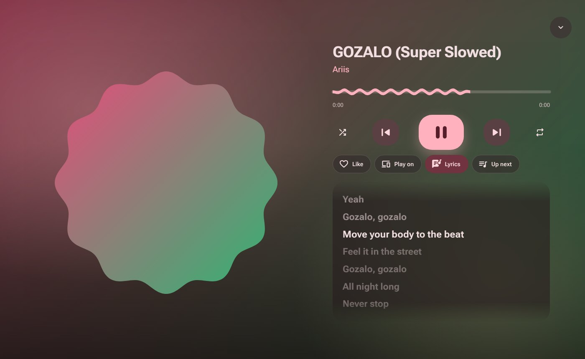
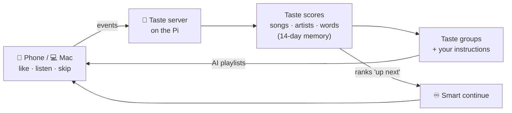

<div align="center">



<br/>
<br/>

[](https://github.com/stormvideo95-dotcom/music.ai/releases?q=build-&expanded=true)
[](https://github.com/stormvideo95-dotcom/music.ai/releases?q=mac-pro&expanded=true)
[](#-iphone-web-app)
[](#-the-taste-server-raspberry-pi)

[](https://github.com/stormvideo95-dotcom/music.ai/actions/workflows/build_apk.yml)
[](https://github.com/stormvideo95-dotcom/music.ai/actions/workflows/build_mac.yml)
[](LICENSE)

**[Download](#-download)** · **[Features](#-features)** · **[How the AI works](#-how-the-ai-works)** · **[Set up the Pi](#-the-taste-server-raspberry-pi)** · **[Credits](#-credits)**

</div>

---

## ✨ What is Music AI?

Music AI is a **personal music system** built on YouTube Music: no ads, a clean design, and a **taste AI that runs on your own Raspberry Pi**. It learns from what you like, finish and skip, and when your playlist ends it keeps going with songs you'll actually like, in the same style.

No cloud account, no tracking: your taste lives on your own Pi.

<div align="center">

<br/>
<sub>Music AI for Mac: Material 3 Expressive design, dynamic colour from the album art, synced lyrics.</sub>
</div>

---

## 🎧 Features

<table>
<tr>
<td width="33%" valign="top">

### 🧠 Taste AI
Learns from likes, full listens and skips. Recent taste counts more, so it follows you when your taste changes.

</td>
<td width="33%" valign="top">

### ♾️ Smart continue
When a playlist ends, the music keeps going with songs in the **same style**, picked by your AI.

</td>
<td width="33%" valign="top">

### 🎛️ Your own playlists
Fixed AI playlists like **Phonk** and **Everything else**, refreshed by themselves. Pick the mood you're in.

</td>
</tr>
<tr>
<td valign="top">

### 📡 Play on
Spotify-style device picker: send the music to your phone, your Mac or a Chromecast, and pick up where you left off.

</td>
<td valign="top">

### ❤️ Shared likes
Like a song on your phone and it's liked on your Mac too, and the other way around.

</td>
<td valign="top">

### 🔐 Pair with a code
Connect a new device with a one-time code. No passwords, no accounts.

</td>
</tr>
<tr>
<td valign="top">

### 🎤 Lyrics
Synced lyrics that follow the song, with plain lyrics as a fallback.

</td>
<td valign="top">

### 🚗 Android Auto
Your music and AI playlists in the car.

</td>
<td valign="top">

### 🚫 No ads
Ad-free playback on every device.

</td>
</tr>
</table>

---

## 📲 Download

| Device | What you get | Download |
|---|---|---|
| 🤖 **Android** | The full app, based on Metrolist | [Latest APK (`build-…`)](https://github.com/stormvideo95-dotcom/music.ai/releases?q=build-&expanded=true) |
| 💻 **Mac** | Own-design desktop app (Apple Silicon and Intel) | [Latest DMG (`mac-pro-…`)](https://github.com/stormvideo95-dotcom/music.ai/releases?q=mac-pro&expanded=true) |
| 📱 **iPhone** | Web app served by the Pi, add it to the Home Screen | [See below](#-iphone-web-app) |

> [!NOTE]
> The Mac app is not signed with an Apple developer certificate. The first time, right-click the app → **Open** → **Open**.

---

## 🧠 How the AI works



1. **It listens.** Every like, full listen and skip is sent to the taste server on your Pi.
2. **It scores.** Songs, artists, albums and title words get a taste score. Old listens slowly count less (half-life of 14 days), so new taste wins.
3. **It groups.** Your liked songs are split into styles, or into the fixed playlists from your own instructions (like *Phonk* vs *Everything else*).
4. **It picks.** When a playlist ends, YouTube Music suggests candidates and the AI ranks them: style you're in now, your scores, at most 2 songs per artist, and a little randomness so you still discover new music.

Everything runs in plain Python with SQLite: no GPU, no cloud.

---

## 🍓 The taste server (Raspberry Pi)

Runs on any Raspberry Pi (tested on a Pi 5 with Umbrel) with Docker.

```bash
git clone https://github.com/stormvideo95-dotcom/music.ai.git
cd music.ai/taste-server
sudo docker compose up -d --build
```

| Service | Port | What it does |
|---|---|---|
| `music-ai-taste` | `8765` | Your taste AI for the phone and Mac apps |
| `music-ai-dad` | `8766` | A second, separate taste AI + the iPhone web app |
| `music-ai-token` | — | Helper that lets the Pi fetch full songs from YouTube |

Then in the app: **Settings → Player and audio → Music AI**, and fill in `http://<your-pi>:8765`.

**Update later:**

```bash
cd ~/music.ai/taste-server && git pull && sudo docker compose up -d --build
```

<details>
<summary><b>API endpoints</b></summary>

| Method | Path | |
|---|---|---|
| `GET` | `/health` | Is the server alive |
| `GET` | `/stats` | What the AI has learned |
| `GET` | `/mixes` | AI playlists |
| `GET` | `/likes` | Shared liked songs |
| `POST` | `/events` | Likes, listens and skips |
| `POST` | `/rank` | Rank "up next" candidates |
| `POST` | `/train` | Retrain now |
| `POST` | `/pair/start`, `/pair/approve` | Pair a device with a one-time code |
| `GET`/`POST` | `/sync/*` | Play on: devices, state, commands |

</details>

---

## 📱 iPhone web app

A separate, Apple-style web app with **its own taste AI**, so its taste never mixes with yours. The Pi fetches the songs and the iPhone just plays them.

1. Open `http://<your-pi>:8766` in Safari (via Tailscale when away from home).
2. Tap **Share → Add to Home Screen**.

**Smart cache:** songs played 3 times or more stay saved on the Pi (on a USB stick if you have one); other songs are removed after a day. The cache never grows past 2 GB.

---

## 🗂️ What's in this repo

```
music.ai/
├── app/            Android app (Kotlin, Jetpack Compose) — fork of Metrolist
│   └── …/tasteai/  Music AI parts: taste AI, AI playlists, Play on, shared likes
├── mac-native/     Mac app (Electron, own design)
├── taste-server/   Taste AI + iPhone web app for the Raspberry Pi (Python, Docker)
└── .github/        Builds the APK and the Mac DMGs automatically
```

---

## 🙏 Credits

Music AI is built on **[Metrolist](https://github.com/MetrolistGroup/Metrolist)**, the open-source YouTube Music client for Android, and keeps its GPL-3.0 license. Huge thanks to the Metrolist team and everyone who worked on the projects it builds on.

Also used: [youtubei.js](https://github.com/LuanRT/YouTube.js) (Mac app), [yt-dlp](https://github.com/yt-dlp/yt-dlp) and [ytmusicapi](https://github.com/sigma67/ytmusicapi) (Pi), [LRCLIB](https://lrclib.net) (lyrics) and [material-color-utilities](https://github.com/material-foundation/material-color-utilities) (dynamic colour).

> [!IMPORTANT]
> Music AI is a personal project and is not affiliated with YouTube or Google. YouTube Music needs to be available in your region.

<div align="center">
<br/>

<br/>
<sub>Made by <b>Storm Gees</b> · <a href="LICENSE">GPL-3.0</a></sub>
</div>
